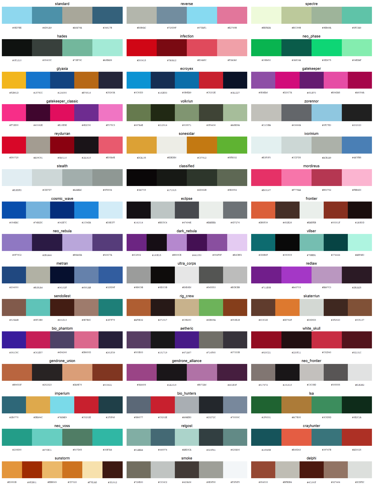
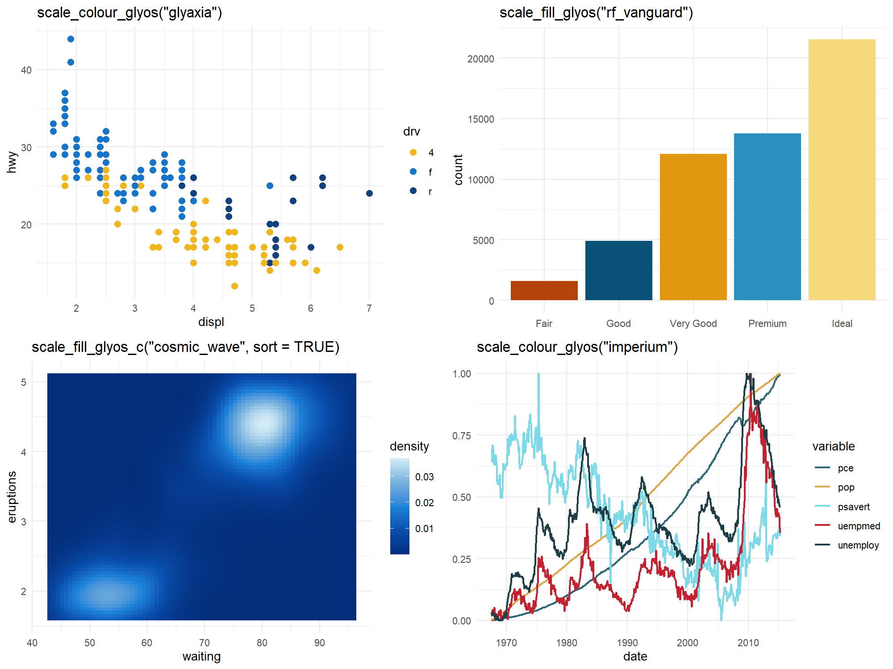
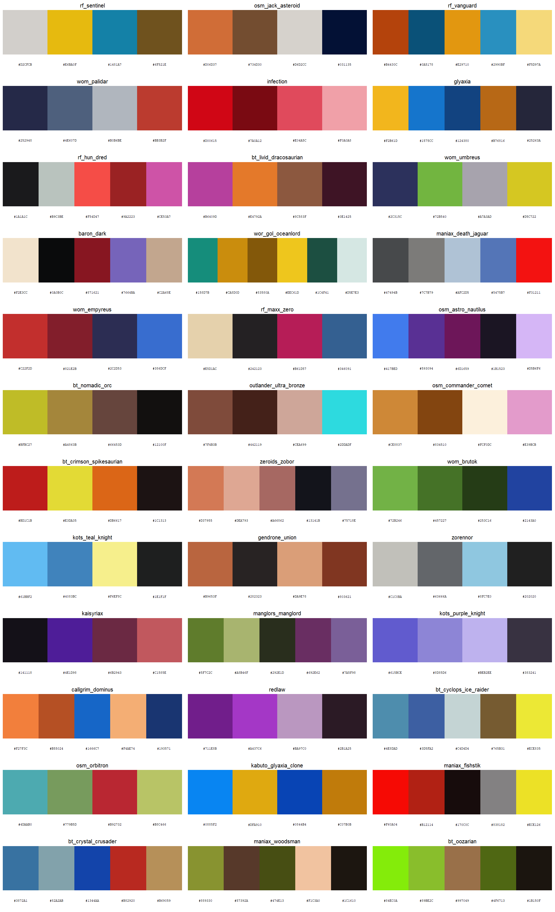

# rglyos

<!-- badges: start -->
[](https://github.com/bmaitner/rglyos/actions/workflows/R-CMD-check.yaml)
<!-- badges: end -->

Color palettes for R and ggplot2 based on the named colorways of the
[Glyos](https://www.onelldesign.com/) toy system: Onell Design's own Glyos
line plus the Glyos-compatible lines from partner companies such as
TheGodBeast (Kabuto Mushi), Spy Monkey Creations (Weaponeers of Monkaa,
Battle Tribes), Toyfinity (Robo Force, Zeroids, Manglors), the Four Horsemen
(Outer Space Men) and a dozen more. It works the same way as packages like
`wesanderson`: pick a colorway by name, get a vector of hex colors, or drop a
scale straight into a ggplot.

rglyos is a fan project and is not affiliated with or endorsed by any of the
companies whose colorways it describes. Hex values are approximations
curated from product photography; see "How the palettes were made" below.

## Installation

```r
# install.packages("pak")
pak::pak("bmaitner/rglyos")
```

## Usage

```r
library(rglyos)

# which companies are covered, and how many palettes each has
glyos_companies()
table(glyos_colorways$company)

# palette names, optionally for one company or product line
glyos_palette_names()
glyos_palette_names(company = "TheGodBeast")
glyos_palette_names(line = "Battle Tribes")

# the colors of one colorway (prints the swatches and the hex codes)
glyos_palette("spectre")
#> Glyos colorway 'spectre' (5 colours)
#> Onell Design / Glyos: Spectre
#> #EEFADA #BCC99B #9EB49A #5FC3A8 #1C1C19

# first three colors, a 12-step gradient, or the same gradient dark-to-light
glyos_palette("glyaxia", 3)
glyos_palette("hades", 12, type = "continuous")
glyos_palette("hades", 12, type = "continuous", sort = TRUE)

# swatches with hex codes, for one company at a time
glyos_show_palettes(company = "Onell Design")
glyos_show_palettes(company = "Spy Monkey Creations", ncol = 2)
```



### ggplot2

`scale_colour_glyos()` and `scale_fill_glyos()` build a discrete scale by
default, or a continuous gradient with `discrete = FALSE`. The explicit
`_d` and `_c` variants and the American `scale_color_*` spellings are also
exported. `sort = TRUE` on a continuous scale orders the palette from
darkest to lightest first.

```r
library(ggplot2)

ggplot(mpg, aes(displ, hwy, colour = drv)) +
  geom_point(size = 2.5) +
  scale_colour_glyos("glyaxia")

ggplot(diamonds, aes(cut, fill = cut)) +
  geom_bar() +
  scale_fill_glyos("rf_vanguard")

ggplot(faithfuld, aes(waiting, eruptions, fill = density)) +
  geom_raster() +
  scale_fill_glyos_c("cosmic_wave", sort = TRUE)

ggplot(economics_long, aes(date, value01, colour = variable)) +
  geom_line() +
  scale_colour_glyos("imperium")
```



Set `reverse = TRUE` to flip a palette. If a discrete variable has more levels
than a palette has colors, the palette is interpolated so every level still
gets a color, at some cost to legibility.

### Finding a palette that works for a plot

Most colorways were designed to look good on a toy, not on a chart.
`glyos_find_palettes()` shortlists the ones whose colors hold up for a given
job, judged from the colors themselves:

```r
glyos_find_palettes("categorical")   # every pair of colours clearly distinct
glyos_find_palettes("colorblind")    # still distinct under simulated CVD
glyos_find_palettes("sequential")    # one hue, wide lightness range
glyos_find_palettes("diverging")     # two hues with a light colour between

# restrict to a company, or see the shortlist as swatches
glyos_find_palettes("colorblind", company = "Onell Design")
glyos_show_palettes(use = "colorblind", ncol = 3)
```



The judgments come from `glyos_palette_stats()`, which reports the smallest
pairwise distance between colors in CIE Lab, the same after simulating
deuteranopia, protanopia and tritanopia, the lightness range, and the hue
spread. The thresholds are simple heuristics, so treat the result as a
shortlist to look at rather than a guarantee.

### Colorway background

`glyos_colorways` is a data frame with one row per palette: the company and
product line, the colorway name as the manufacturer uses it, the year and
wave of the reference release where known, a description of the colors, and
a link to the reference figure in the Official Glyos Database (Onell) or the
Glyos Wiki (partners).

```r
glyos_colorways[glyos_colorways$palette == "kabuto_infection", ]
#>            palette     company         line  colorway year wave n_colours
#> 47 kabuto_infection TheGodBeast Kabuto Mushi Infection 2014 <NA>         5
#>                                 description      reference_figure
#> 47 Clear red plastic with orange accents. Infection Kabuto Mushi
#>                                                     source
#> 47 https://glyos.fandom.com/wiki/Infection_Kabuto_Mushi
```

## Coverage

| Company | Line(s) | Palettes | Prefix |
|---|---|---|---|
| Onell Design | Glyos | 45 | none, e.g. `spectre`, `glyaxia` |
| TheGodBeast | Kabuto Mushi | 10 | `kabuto_` |
| Spy Monkey Creations | Weaponeers of Monkaa, Battle Tribes | 18 | `wom_`, `bt_` |
| Toyfinity | Robo Force, Mordles, Zeroids, Manglors | 12 | `rf_`, `mordles_`, `zeroids_`, `manglors_` |
| Four Horsemen Studio | Outer Space Men, Power Lords | 12 | `osm_`, `powerlords_` |
| Toy Pizza | Knights of the Slice | 10 | `kots_` |
| Rocom Toys | Mighty Maniax | 10 | `maniax_` |
| Bio-Masters Design | Bio-Masters | 8 | `biomass_` |
| Rawshark Studio | Callgrim | 10 | `callgrim_`, `order_` |
| ManOrMonster? Studios | Warlords of Wor | 10 | `wor_` |
| NiStuff | Outlander | 10 | `outlander_` |
| Nemo's Factory | A/V Robot | 8 | `avrobot_` |
| Cappy Space | Cappy Space | 8 | `cappy_` |
| Banimon | Banimon | 6 | `banimon_` |
| Culture Pirates | Bit Figs | 5 | `bitfigs_` |
| October Toys | Skeleton Warriors, Breaker Buildman | 4 | none |
| Zullbeasts | Zullbeasts | 4 | none |
| Spaced Out Design | Spaced Out, Rise of Acris | 3 | none |

Every partner company's palettes are drawn in `man/figures/palettes-<company>.png`;
the Onell set is shown above. The Onell palettes cover the classic colorways
(Standard, Reverse, Spectre, Hades Force, Infection, Neo Phase, Glyaxia,
Gatekeeper, Stealth, Classified and so on) plus the named division and faction
waves. Partner palettes are named after a representative figure or edition
in that line.

## How the palettes were made

There is no published set of hex values for Glyos colorways, so these are
approximations built in three steps:

1. Each colorway was matched to a representative figure. For Onell Design
   that is an entry in the [Official Glyos Database](https://database.glyos.com/),
   preferring a Pheyden or Glyan so that body, secondary and paint colors are
   all visible. For partner companies it is the figure's page on the
   [Glyos Wiki](https://glyos.fandom.com/).
2. The dominant colors of that figure's lead photograph were extracted with
   k-means clustering, after masking out pixels that match the photo's
   border colors so that studio backgrounds, rocks and tabletops do not leak
   into the palette.
3. The clusters were reconciled by eye against the manufacturer's own color
   descriptions where they exist, chiefly the Onell drop announcements on the
   [Glyos Transmission Web Log](https://onelldesign.blogspot.com/) (for
   example "Pappysoup Green/Olive Green with light green visors and white
   tampo", or "Cool Gray 1C + Cool Gray 8C + Cool Gray 10C detail lines" for
   Zorennor) and the wiki's release lists, and ordered so the first few
   colors in each palette are the most distinct.

Each palette contains only plastic and paint colors, so a colorway cast in a
single clear plastic yields a short palette of that hue's highlight, mid-tone
and shadow, and a two-color colorway such as Kabuto Mushi Radioactive is just
two colors. Palettes range from 2 to 6 colors. Clear, glow-in-the-dark,
metallic and pearlescent plastics do not reduce to a single flat color; those
palettes reflect how the plastic photographs rather than the pigment itself. Partner-company photographs vary more in lighting
and background than Onell's, so expect those palettes to be rougher.
Corrections are welcome, ideally with a photograph or a manufacturer color
description to back them up; `glyos_show_palettes()` prints the hex codes
under each swatch to make that easy.

## Trademarks

Glyos, Pheyden and the Onell Design colorway names belong to Onell Design.
Kabuto Mushi, Weaponeers of Monkaa, Battle Tribes, Robo Force, Zeroids,
Manglors, Mordles, Outer Space Men, Power Lords, Knights of the Slice, Mighty
Maniax, Bio-Masters, Callgrim, Warlords of Wor, Outlander, A/V Robot, Bit
Figs, Banimon, Skeleton Warriors and Zullbeasts belong to their respective
companies. This package only records approximate color values and uses the
names to refer to them.
