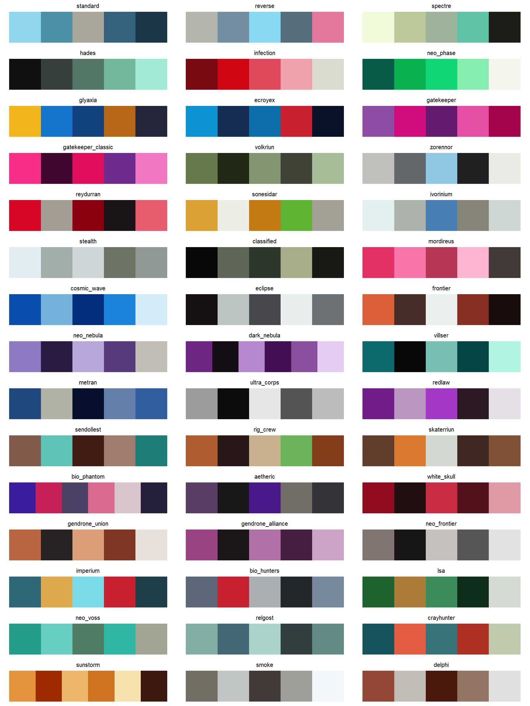

# rglyos

Color palettes for R and ggplot2 based on the named production colorways of
the [Glyos System Series](https://www.onelldesign.com/) toy line by Onell
Design. It works the same way as packages like `wesanderson`: pick a colorway
by name, get a vector of hex colors, or drop a scale straight into a ggplot.

rglyos is a fan project and is not affiliated with or endorsed by Onell
Design. Hex values are approximations curated from product photography and
Onell's published color descriptions; see "How the palettes were made" below.

## Installation

```r
# install.packages("pak")
pak::pak("bmaitner/rglyos")
```

## Usage

```r
library(rglyos)

# every palette name
glyos_palette_names()

# the colors of one colorway (prints swatches too)
glyos_palette("spectre")
#> Glyos colorway 'spectre' (5 colours)
#> #EEFADA #BCC99B #9EB49A #5FC3A8 #1C1C19

# first three colors, or a 12-step gradient across the palette
glyos_palette("glyaxia", 3)
glyos_palette("hades", 12, type = "continuous")

# see them all
glyos_show_palettes()
```



### ggplot2

`scale_colour_glyos()` and `scale_fill_glyos()` build a discrete scale by
default, or a continuous gradient with `discrete = FALSE`. The explicit
`_d` and `_c` variants and the American `scale_color_*` spellings are also
exported.

```r
library(ggplot2)

ggplot(mpg, aes(displ, hwy, colour = drv)) +
  geom_point(size = 2.5) +
  scale_colour_glyos("glyaxia")

ggplot(diamonds, aes(cut, fill = clarity)) +
  geom_bar() +
  scale_fill_glyos("gatekeeper")

ggplot(faithfuld, aes(waiting, eruptions, fill = density)) +
  geom_tile() +
  scale_fill_glyos_c("spectre")

ggplot(mpg, aes(displ, hwy, colour = cty)) +
  geom_point(size = 2.5) +
  scale_colour_glyos_c("hades")
```


Set `reverse = TRUE` to flip a palette. If a discrete variable has more levels
than a palette has colors, the palette is interpolated so every level still
gets a color, at some cost to legibility.

### Colorway background

`glyos_colorways` is a data frame with one row per palette: the colorway name
as Onell uses it, the year and wave of the reference release, a description
of the plastic and paint colors, and a link to the reference figure in the
Official Glyos Database.

```r
glyos_colorways[glyos_colorways$palette == "volkriun", ]
#>    palette            colorway year wave n_colours
#> 11 volkriun Task Force Volkriun 2011   16         5
#>                                                       description
#> 11 Pappysoup green and olive green plastic with light green visors.
#>            reference_figure                                                          source
#> 11 Glyan Task Force Volkriun https://database.glyos.com/2011/07/glyan-task-force-volkriun.html
```

## Palettes

| Palette | Colorway | Year | Colors |
|---|---|---|---|
| `standard` | Standard | 2007 (Wave 1) | light blue, grey |
| `reverse` | Reverse | 2007 (Wave 1) | grey, light blue, pink eyes |
| `spectre` | Spectre | 2009 (Wave 7) | glow-in-the-dark green, aqua |
| `hades` | Hades Force | 2012 (Wave 23) | black, aqua, glow green |
| `infection` | Infection | 2011 (Wave 13) | clear red |
| `neo_phase` | Neo Phase | 2010 (Wave 12) | clear neon green |
| `glyaxia` | Glyaxia Command | 2010 (Wave 10) | yellow, blue |
| `ecroyex` | Ecroyex | 2013 (Wave 32) | bright blue, dark blue, red |
| `gatekeeper` | Neo Gatekeeper | 2013 (Wave 30) | warm purple, magenta |
| `gatekeeper_classic` | Gatekeeper | 2010 (Wave 11) | hot pink, dark purple |
| `volkriun` | Task Force Volkriun | 2011 (Wave 16) | pappysoup green, olive |
| `zorennor` | Zorennor Exploration Division | 2012 (Wave 20) | cool greys, light blue |
| `reydurran` | Reydurran Science Division | 2013 (Wave 27) | red, warm grey |
| `sonesidar` | Sonesidar Rescue Unit | 2013 (Wave 26) | yellorange, white, green |
| `ivorinium` | Ivorinium | 2013 (Wave 28) | pearlescent white, blue |
| `stealth` | Stealth | 2009 (Wave 7) | clear colorless |
| `classified` | Classified | 2009 (Wave 6) | black |
| `mordireus` | Mordireus | 2012 (Wave 25) | neon clear pink |
| `cosmic_wave` | Cosmic Wave | 2008 (Wave 3) | clear blue |
| `eclipse` | Eclipse | 2008 (Wave 3) | black, white |
| `frontier` | Frontier | 2008 (Wave 2) | orange, brown, white |
| `neo_nebula` | Neo Nebula | 2012 (Wave 24) | light and dark purple |
| `dark_nebula` | Dark Nebula | 2019 (Wave 83) | deep purples |
| `villser` | Villser Standard | 2017 (Wave 66) | black, teal, aqua |
| `metran` | Metran Security Command | 2015 (Wave 42) | Metran blue, grey |
| `ultra_corps` | Gendrone Ultra Corps | 2014 (Wave 34) | ultra silver, black |
| `redlaw` | Redlaw | 2014 (Wave 41) | clear purple, silver |
| `sendollest` | Sendollest Guard | 2015 (Wave 44) | ultra bronze, aqua |
| `rig_crew` | Rig Crew | 2014 (Wave 39) | brown, black, sand, green |
| `skaterriun` | Skaterriun Skull Commando | 2017 (Wave 63) | brown, orange, white |
| `bio_phantom` | Bio Phantom | 2022 (Wave 95) | clear violet, pink |
| `aetheric` | Core Aetheric | 2022 (Wave 95) | dark grey-green, violet |
| `white_skull` | Strike Team White Skull | 2011 (Wave 18) | red, maroon |
| `gendrone_union` | Gendrone Union | 2017 (Wave 69) | metallic copper |
| `gendrone_alliance` | Gendrone Alliance | 2017 (Wave 67) | metallic magenta |
| `neo_frontier` | Neo Frontier | 2019 (Wave 85) | warm grey, black, white |
| `imperium` | Gendrone Imperium | 2015 (Wave 48) | metallic teal, gold, red |
| `bio_hunters` | Bio Hunters | 2015 (Wave 46) | gunmetal silver, red |
| `lsa` | Lost Sincroid Army | 2014 (Wave 37) | green, gold, cream |
| `neo_voss` | Neo Voss | 2012 (Wave 21) | clear aqua green |
| `relgost` | Relgost Marine Division | 2011 (Wave 17) | seafoam green, greyish blue |
| `crayhunter` | Crayhunter | 2014 (Wave 38) | grayeen blue, redorange |
| `sunstorm` | Sunstorm | 2016 (Wave 53) | pearlescent yellow, orange |
| `smoke` | Clear Smoke | 2010 (Wave 10) | clear grey |
| `delphi` | Delphi | 2020 (Wave 89) | reddish brown, bone |

The year and wave listed here are the colorway's first appearance where that
is known; `glyos_colorways` records the specific later release that each
palette was sampled from.

## How the palettes were made

There is no published set of hex values for Glyos colorways, so these are
approximations built in three steps:

1. Each colorway was matched to a representative figure in the
   [Official Glyos Database](https://database.glyos.com/), preferring a
   Pheyden or Glyan so that body, secondary and paint colors are all visible.
2. The dominant colors of that figure's product photograph were extracted
   with k-means clustering.
3. The clusters were reconciled by eye against Onell's own color descriptions
   from the drop announcements on the
   [Glyos Transmission Web Log](https://onelldesign.blogspot.com/) (for
   example "Pappysoup Green/Olive Green with light green visors and white
   tampo", or "Cool Gray 1C + Cool Gray 8C + Cool Gray 10C detail lines" for
   Zorennor), and ordered so the first few colors in each palette are the
   most distinct.

Clear, glow-in-the-dark, metallic and pearlescent plastics do not reduce to a
single flat color; those palettes reflect how the plastic photographs rather
than the pigment itself. Corrections are welcome, ideally with a photograph
or an Onell color description to back them up.

## Code of conduct

Glyos, Pheyden, Glyan and the colorway names are the property of Onell Design.
This package only records approximate color values and uses the names to
refer to them.
