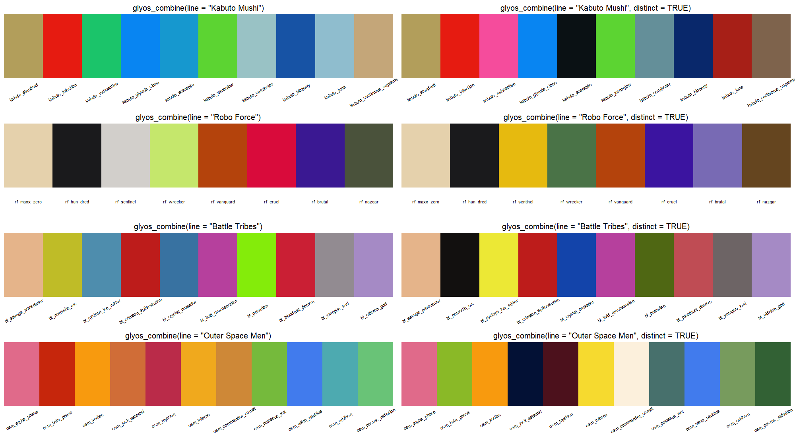
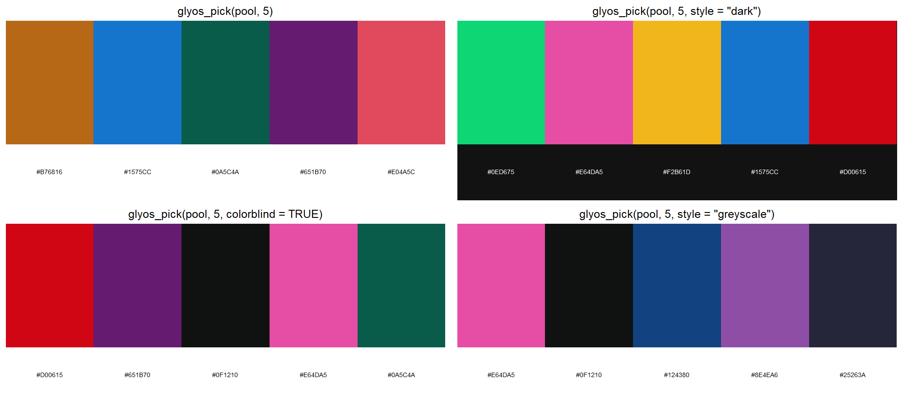

# glyospalettes

<!-- badges: start -->
[](https://CRAN.R-project.org/package=glyospalettes)
[](https://github.com/bmaitner/glyospalettes/actions/workflows/R-CMD-check.yaml)
[](https://doi.org/10.5281/zenodo.23734114)
<!-- badges: end -->

Color palettes for R and ggplot2 based on the named colorways of the
[Glyos](https://onelldesign.blogspot.com/) toy system: Onell Design's own Glyos
line plus the Glyos-compatible lines from partner companies such as
TheGodBeast (Kabuto Mushi), Spy Monkey Creations (Weaponeers of Monkaa,
Battle Tribes), Toyfinity (Robo Force, Zeroids, Manglors), the Four Horsemen
(Outer Space Men) and a dozen more. It works the same way as packages like
`wesanderson`: pick a colorway by name, get a vector of hex colors, or drop a
scale straight into a ggplot.

glyospalettes is a fan project and is not affiliated with or endorsed by any of the
companies whose colorways it describes. Hex values are approximations
curated from product photography; see "How the palettes were made" below.

## Browse online

Every palette, with its colors, reference photo and provenance, is browsable
and filterable at <https://bmaitner.github.io/glyospalettes/articles/browse.html>.
Each card has a **Suggest a change** link that opens a prefilled GitHub issue
where you can propose different colors or attach a cleaner photograph.

## Installation

```r
install.packages("glyospalettes")

# or the development version from GitHub
# install.packages("pak")
pak::pak("bmaitner/glyospalettes")
```

## Usage

```r
library(glyospalettes)

# which companies are covered, and how many palettes each has
glyos_companies()
table(glyos_colorways$company)

# palette names, optionally for one company or product line
glyos_palette_names()
glyos_palette_names(company = "TheGodBeast")
glyos_palette_names(line = "Battle Tribes")

# the colors of one colorway (prints the swatches and the hex codes)
glyos_palette("spectre")
#> Glyos colorway 'spectre' (4 colors)
#> Onell Design / Glyos: Spectre
#> #EEFADA #BCC99B #9EB49A #5FC3A8

# first three colors, a 12-step gradient, or the same gradient dark-to-light
glyos_palette("glyaxia", 3)
glyos_palette("hades", 12, type = "continuous")
glyos_palette("hades", 12, type = "continuous", sort = TRUE)

# swatches with hex codes, for one company at a time
glyos_show_palettes(company = "Onell Design")
glyos_show_palettes(company = "Spy Monkey Creations", ncol = 2)

# one color per colorway, or the most separable few colors from a pool
glyos_combine(line = "Kabuto Mushi")
glyos_pick(c("glyaxia", "hades"), n = 5)
```


### ggplot2

`scale_color_glyos()` and `scale_fill_glyos()` build a discrete scale by
default, or a continuous gradient with `discrete = FALSE`. The explicit
`_d` and `_c` variants are also exported, and `scale_colour_*` spellings work as aliases. `sort = TRUE` on a continuous scale orders the palette from
darkest to lightest first.

```r
library(ggplot2)

ggplot(mpg, aes(displ, hwy, color = drv)) +
  geom_point(size = 2.5) +
  scale_color_glyos("glyaxia")

ggplot(diamonds, aes(cut, fill = cut)) +
  geom_bar() +
  scale_fill_glyos("rf_vanguard")

ggplot(faithfuld, aes(waiting, eruptions, fill = density)) +
  geom_raster() +
  scale_fill_glyos_c("cosmic_wave", sort = TRUE)

ggplot(economics_long, aes(date, value01, color = variable)) +
  geom_line() +
  scale_color_manual(values = unname(glyos_combine(c("glyaxia", "hades", "infection", "neo_phase", "gatekeeper"))))
```


Set `reverse = TRUE` to flip a palette. If a discrete variable has more levels
than a palette has colors, the palette is interpolated so every level still
gets a color, at some cost to legibility.

### Combining palettes

`glyos_combine()` takes one color from each of a set of palettes, either
named explicitly or all the palettes of a company or product line, and names
each color after the colorway it came from. By default it takes the main
plastic color of each, which is faithful but can repeat across a line cast
from shared plastics; `distinct = TRUE` picks, for each palette in turn, the
color from that palette that is farthest from the colors chosen so far.

```r
glyos_combine(c("standard", "spectre", "hades", "infection", "glyaxia"))
#> Glyos combined palette 'standard + spectre + hades + infection + glyaxia' (5 colors)
#> standard = #8ED7EE
#> spectre = #EEFADA
#> hades = #0F1210
#> infection = #D00615
#> glyaxia = #F2B61D

glyos_combine(line = "Kabuto Mushi")                  # main plastic of each Mushi
glyos_combine(line = "Kabuto Mushi", distinct = TRUE) # spread out for a chart
glyos_combine(company = "Toyfinity", which = 2)       # second color of each
```



### Picking the best few colors from one or more palettes

Whole palettes are faithful to the figures, not to the chart. `glyos_pick()`
pools the colors of the palettes you name (or of a whole company or line),
drops any that would not read against the background (white for `"light"`
and `"grayscale"`, near-black for `"dark"`, judged by WCAG contrast), and
then chooses the `n` colors whose closest pair is farthest apart in CIE Lab.
With `colorblind = TRUE` the distance is the worst case across simulated
deuteranopia, protanopia and tritanopia; with `style = "grayscale"` only
lightness counts, so the result survives a black-and-white printer.

```r
# five colors for a white-background plot, from two classic colorways
glyos_pick(c("glyaxia", "hades"), n = 5)

# four color-blind-safe colors for a dark theme, from a whole line
glyos_pick(line = "Kabuto Mushi", n = 4, style = "dark", colorblind = TRUE)

# printable in grayscale, from everything Toyfinity made
glyos_pick(company = "Toyfinity", n = 4, style = "grayscale")

ggplot(mpg, aes(displ, hwy, color = drv)) +
  geom_point(size = 2.5) +
  scale_color_manual(values = unname(glyos_pick(c("glyaxia", "hades"), 3)))
```



Each color is named after the palette it came from, and the `min_distance`
attribute reports how separable the closest pair is (above 20 is
comfortable, below about 12 is risky). The contrast filter is strict on
purpose: pale glow-in-the-dark and clear colors fail it against white, so a
light-mode pick from Spectre alone has nothing to work with. Lower
`min_contrast` to keep them, or pass a different `background`.

### Finding a palette that works for a plot

Most colorways were designed to look good on a toy, not on a chart.
`glyos_find_palettes()` shortlists the ones whose colors hold up for a given
job, judged from the colors themselves:

```r
glyos_find_palettes("categorical")   # every pair of colors clearly distinct
glyos_find_palettes("colorblind")    # still distinct under simulated CVD
glyos_find_palettes("sequential")    # one hue, wide lightness range
glyos_find_palettes("diverging")     # two hues with a light color between

# restrict to a company, or see the shortlist as swatches
glyos_find_palettes("colorblind", company = "Onell Design")
glyos_show_palettes(use = "colorblind", ncol = 3)
```


The judgments come from `glyos_palette_stats()`, which reports the smallest
pairwise distance between colors in CIE Lab, the same after simulating
deuteranopia, protanopia and tritanopia, the lightness range, and the hue
spread. The thresholds are simple heuristics, so treat the result as a
shortlist to look at rather than a guarantee.

### Crediting the designers

The colors belong to the people who designed the toys, so give them a line.
`glyos_credit()` writes that line from the palette metadata, grouped by
company, and follows a `glyos_pick()` or `glyos_combine()` result back to
every colorway that contributed. The caption form is one sentence; the
acknowledgment form adds that the hex values are approximations that imply
no endorsement, which is the wording journals tend to want. Cite the package
itself with `citation("glyospalettes")`.

```r
glyos_credit("kots_vice_knight")
#> [1] "Colors: Vice Knight colorway by Toy Pizza (Knights of the Slice), via the glyospalettes R package."

glyos_credit(c("glyaxia", "hades", "kabuto_infection"))
#> [1] "Colors: Glyaxia Command and Hades Force colorways by Onell Design (Glyos) and Infection colorway by TheGodBeast (Kabuto Mushi), via the glyospalettes R package."

glyos_credit("glyaxia", format = "acknowledgment")
#> [1] "Figure colors are derived from the Glyaxia Command colorway designed by Onell Design (Glyos). Hex values are approximations from the glyospalettes R package (Maitner 2026) and imply no endorsement by the designers."

# straight into a figure caption
cols <- glyos_pick(c("glyaxia", "kabuto_infection"), n = 3)
ggplot(mpg, aes(displ, hwy, color = drv)) +
  geom_point(size = 2.5) +
  scale_color_manual(values = unname(cols)) +
  labs(caption = glyos_credit(cols))
```

`format = "markdown"` links each colorway name to its reference page, for
Quarto and R Markdown captions, and `package = FALSE` drops the package
mention when it is cited elsewhere.

### Colorway background

`glyos_colorways` is a data frame with one row per palette: the company and
product line, the colorway name as the manufacturer uses it, the year and
wave of the reference release where known, a description of the colors, and
a link to the reference figure in the Official Glyos Database (Onell) or the
Glyos Wiki (partners).

```r
t(glyos_colorways[glyos_colorways$palette == "volkriun", ])
#> palette          "volkriun"
#> company          "Onell Design"
#> line             "Glyos"
#> colorway         "Task Force Volkriun"
#> year             "2011"
#> wave             "Wave 16"
#> n_colours        "5"
#> description      "Pappysoup green and olive green plastic with light green visors."
#> reference_figure "Glyan Task Force Volkriun"
#> source           "https://database.glyos.com/2011/07/glyan-task-force-volkriun.html"
#> image            "https://blogger.googleusercontent.com/img/.../archive-glyan-volkriun.jpeg"
```

The `image` column is a direct link to the photograph each palette was
sampled from, which is what the online browser shows.

## Coverage

| Company | Line(s) | Palettes | Prefix |
|---|---|---|---|
| Onell Design | Glyos | 45 | none, e.g. `spectre`, `glyaxia` |
| TheGodBeast | Kabuto Mushi | 10 | `kabuto_` |
| Spy Monkey Creations | Weaponeers of Monkaa, Battle Tribes | 20 | `wom_`, `bt_` |
| Toyfinity | Robo Force, Mordles, Zeroids, Manglors | 12 | `rf_`, `mordles_`, `zeroids_`, `manglors_` |
| Four Horsemen Studio | Outer Space Men, Power Lords | 12 | `osm_`, `powerlords_` |
| Toy Pizza | Knights of the Slice | 10 | `kots_` |
| Rocom Toys | Mighty Maniax | 14 | `maniax_` |
| Bio-Masters Design | Bio-Masters | 8 | `biomass_` |
| Rawshark Studio | Callgrim | 10 | `callgrim_`, `order_` |
| ManOrMonster? Studios | Warlords of Wor | 12 | `wor_` |
| NiStuff | Outlander | 10 | `outlander_` |
| Nemo's Factory | A/V Robot | 10 | `avrobot_` |
| Cappy Space | Cappy Space | 9 | `cappy_` |
| Banimon | Banimon | 6 | `banimon_` |
| Culture Pirates | Bit Figs | 5 | `bitfigs_` |
| October Toys | Skeleton Warriors, Breaker Buildman | 4 | none |
| Zullbeasts | Zullbeasts | 4 | none |
| Swamp City Collectibles | Paleolords | 4 | `paleo_` |
| Spaced Out Design | Spaced Out, Rise of Acris | 3 | none |

Every partner company's palettes are drawn in `man/figures/palettes-<company>.png`;
the Onell set is shown above. The Onell palettes cover the classic colorways
(Standard, Reverse, Spectre, Hades Force, Infection, Neo Phase, Glyaxia,
Gatekeeper, Stealth, Classified and so on) plus the named division and faction
waves. Partner palettes are named after a representative figure or edition
in that line.

## How the palettes were made

There is no published set of hex values for Glyos colorways, so these are
approximations built in three steps:

1. Each colorway was matched to a representative figure. For Onell Design
   that is an entry in the [Official Glyos Database](https://database.glyos.com/),
   preferring a Pheyden or Glyan so that body, secondary and paint colors are
   all visible. For partner companies it is the figure's page on the
   Glyos Wiki (glyos.fandom.com).
2. The dominant colors of that figure's lead photograph were extracted with
   k-means clustering, after masking out pixels that match the photo's
   border colors so that studio backgrounds, rocks and tabletops do not leak
   into the palette.
3. The clusters were reconciled by eye against the manufacturer's own color
   descriptions where they exist, chiefly the Onell drop announcements on the
   [Glyos Transmission Web Log](https://onelldesign.blogspot.com/) (for
   example "Pappysoup Green/Olive Green with light green visors and white
   tampo", or "Cool Gray 1C + Cool Gray 8C + Cool Gray 10C detail lines" for
   Zorennor) and the wiki's release lists, and ordered so the first few
   colors in each palette are the most distinct.

Each palette contains only plastic and paint colors, so a colorway cast in a
single clear plastic yields a short palette of that hue's highlight, mid-tone
and shadow, and a two-color colorway such as Kabuto Mushi Radioactive is just
two colors. Palettes range from 2 to 6 colors. Clear, glow-in-the-dark,
metallic and pearlescent plastics do not reduce to a single flat color; those
palettes reflect how the plastic photographs rather than the pigment itself. Partner-company photographs vary more in lighting
and background than Onell's, so expect those palettes to be rougher.
Corrections are welcome, ideally with a photograph or a manufacturer color
description to back them up. Use the
[palette browser](https://bmaitner.github.io/glyospalettes/articles/browse.html) to
open a prefilled issue for a specific palette, or pick a form from the
[issue templates](https://github.com/bmaitner/glyospalettes/issues/new/choose):
suggest a palette change, submit a cleaner reference photo (plain background,
neutral light), or propose a new colorway. `glyos_show_palettes()` prints the
hex codes under each swatch to make reporting easy.

## Trademarks

Glyos, Pheyden and the Onell Design colorway names belong to Onell Design.
Kabuto Mushi, Weaponeers of Monkaa, Battle Tribes, Robo Force, Zeroids,
Manglors, Mordles, Outer Space Men, Power Lords, Knights of the Slice, Mighty
Maniax, Bio-Masters, Callgrim, Warlords of Wor, Outlander, A/V Robot, Bit
Figs, Banimon, Skeleton Warriors, Zullbeasts and Paleolords belong to their respective
companies. This package only records approximate color values and uses the
names to refer to them.
